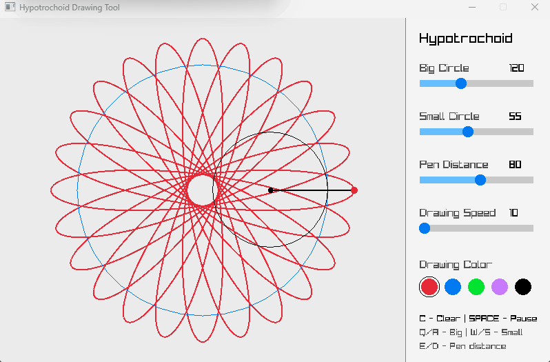

# Hypotrochoid Drawing Tool

An interactive Hypotrochoid (Spirograph) drawing application developed in **C++ using raylib**.

The program simulates a smaller circle rolling inside a larger fixed circle, generating a mathematical curve.

## Demo

## Features

- Animated hypotrochoid drawing
- Adjustable big circle radius
- Adjustable small circle radius
- Adjustable pen distance
- Adjustable drawing speed
- Multiple drawing colors
- Automatic drawing reset when changing circle dimensions
- Pause, resume, and clear controls
- Visualization of the rolling circles

## Technologies

- C++
- raylib
- Visual Studio
- vcpkg

## Controls

| Key | Action |
|---|---|
| C | Clear and restart drawing |
| Space | Pause / Resume |
| Q / A | Increase / Decrease big circle radius |
| W / S | Increase / Decrease small circle radius |
| E / D | Increase / Decrease pen distance |

The settings panel also provides sliders for adjusting the circles, pen distance, and drawing speed.

## How to Run

1. Clone the repository.
2. Open the Visual Studio solution (`.sln`).
3. Install raylib using vcpkg if it is not already installed.
4. Select the x64 build configuration.
5. Build and run the project.

## Mathematical Formula

The hypotrochoid is generated using:

\[
x(t) = (R-r)\cos(t) + d\cos\left(\frac{R-r}{r}t\right)
\]

\[
y(t) = (R-r)\sin(t) - d\sin\left(\frac{R-r}{r}t\right)
\]

Where:

- R = radius of the big circle
- r = radius of the small circle
- d = distance from the small circle's center to the drawing point
- t = rotation angle
